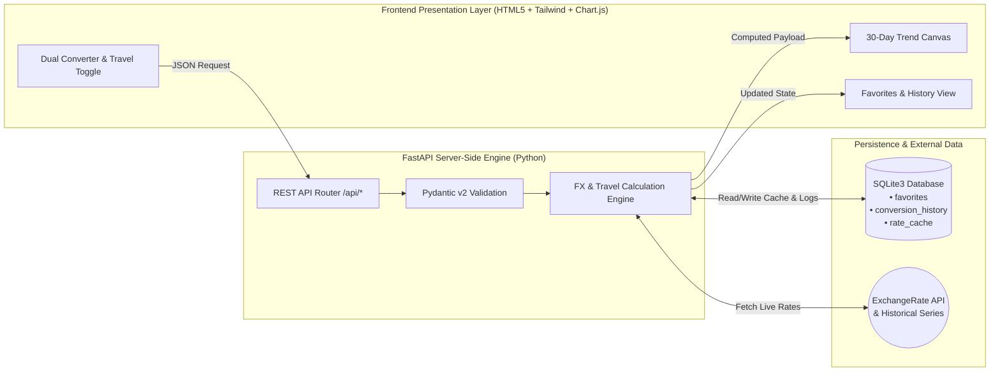

<div align="center">

# 💱 FX Pulse — Real-Time Currency Converter & Travel Budget Engine

[](https://www.python.org/)
[](https://fastapi.tiangolo.com/)
[](https://www.sqlite.org/)
[](https://tailwindcss.com/)
[](https://www.chartjs.org/)

**A high-speed, server-driven currency conversion utility with 30-day historical trend visualization, SQLite caching, and simultaneous multi-currency Travel Budgeting.**

[✨ Core Features](#-core-features) • [🏗️ System Architecture](#️-system-architecture) • [🚀 Quick Start](#-quick-start-in-60-seconds) • [📡 API Reference](#-interactive-api-reference) • [🧠 Engineering Decisions](#-interactive-engineering--viva-notes)

</div>

---

## ✨ Core Features

| Feature Module | Engineering Implementation | User Experience |
| :--- | :--- | :--- |
| **🔄 Dual Currency Converter** | Strict server-side validation via Pydantic v2 & live rate resolution via **ExchangeRate API**. | Side-by-side Source & Target currency selectors, instant swap (`⇄`), and inverse rate breakdown. |
| **📈 30-Day Trend Analytics** | Backend time-series aggregation computing 30-day `min`, `max`, and `% change` metrics. | Interactive **Chart.js** area-line graph visualizing daily exchange rate volatility. |
| **⭐ Favorites Quick-Bar** | Persistent **SQLite** storage with unique pair constraints (`UNIQUE(source, target)`). | One-click pill selectors to switch currency pairs or add/remove frequent pairs in real time. |
| **🗄️ Local Conversion History** | Automated **SQLite** write-through logging + 15-minute TTL rate caching (`rate_cache`). | Live-updating audit table displaying the 10 most recent conversions with zero latency. |
| **✈️ "The Vibe Check": Travel Budgeting Mode** | Simultaneous server-side matrix computation across **5 major global currencies** (`USD`, `EUR`, `GBP`, `JPY`, `AUD`/`CAD`). | Dedicated toggle mode rendering an instant 5-currency purchasing power comparison table. |

---

## 🏗️ System Architecture

All business logic, input validations, financial calculations, and third-party API integrations are strictly decoupled and executed on the **FastAPI backend**. The frontend acts purely as a lightweight presentation and interaction layer.



### 📂 Repository Structure

```text
currency-converter/
├── app/
│   ├── __init__.py
│   ├── main.py              # FastAPI lifecycle, CORS, and static asset mounting
│   ├── config.py            # Environment settings, cache TTL, and global currency constants
│   ├── database.py          # SQLite3 connection manager, schema init, and CRUD helpers
│   ├── schemas.py           # Strict server-side Pydantic v2 request/response validators
│   ├── services/
│   │   └── fx_service.py    # ExchangeRate API client, SQLite caching, 30d trends, & Travel Mode math
│   └── api/
│       └── routes.py        # RESTful endpoints (/convert, /trends, /travel-budget, /favorites, /history)
├── frontend/
│   ├── index.html           # Responsive UI with Dual Converter, Chart.js canvas, & Travel Mode toggle
│   └── app.js               # Pure DOM event listeners & fetch() calls (zero client-side math)
├── requirements.txt         # Pinned production dependencies
└── README.md                # Project documentation
```

---

## 🚀 Quick Start (In 60 Seconds)

### 1. Clone & Initialize Environment
```bash
git clone <YOUR_GITHUB_REPO_URL>
cd currency-converter

# Create and activate virtual environment
python -m venv venv
# Windows (Git Bash):
source venv/Scripts/activate
# Windows (PowerShell):
.\venv\Scripts\Activate.ps1
# Linux / macOS:
source venv/bin/activate
```

### 2. Install Dependencies
```bash
pip install -r requirements.txt
```

### 3. Launch the Application
```bash
uvicorn app.main:app --reload --host 127.0.0.1 --port 8000
```

* 🌐 **Web Application UI:** [http://127.0.0.1:8000](http://127.0.0.1:8000)
* 📘 **Interactive Swagger API Docs:** [http://127.0.0.1:8000/docs](http://127.0.0.1:8000/docs)

---

## 📡 Interactive API Reference

<details>
<summary><b>1. <code>POST /api/convert</code> — Server-Side Dual Currency Conversion</b> (Click to expand)</summary>

Validates ISO currency codes and positive amounts on the server, fetches live rates (or hits the SQLite TTL cache), logs the transaction to `conversion_history`, and returns the computed values.

**Request Payload:**
```json
{
  "source_currency": "USD",
  "target_currency": "INR",
  "amount": 250.00
}
```

**Response (`200 OK`):**
```json
{
  "source_currency": "USD",
  "target_currency": "INR",
  "amount": 250.0,
  "converted_amount": 20987.5,
  "exchange_rate": 83.95,
  "inverse_rate": 0.011912
}
```
</details>

<details>
<summary><b>2. <code>POST /api/travel-budget</code> — Simultaneous 5-Currency Travel Mode ("The Vibe Check")</b> (Click to expand)</summary>

Accepts a single base currency and budget amount, dynamically selecting 5 distinct major global currencies and computing all equivalent values on the backend.

**Request Payload:**
```json
{
  "base_currency": "INR",
  "amount": 100000
}
```

**Response (`200 OK`):**
```json
{
  "base_currency": "INR",
  "base_amount": 100000.0,
  "comparisons": [
    { "currency_code": "USD", "currency_name": "US Dollar", "symbol": "$", "exchange_rate": 0.0119, "converted_amount": 1191.20 },
    { "currency_code": "EUR", "currency_name": "Euro", "symbol": "€", "exchange_rate": 0.0108, "converted_amount": 1084.50 },
    { "currency_code": "GBP", "currency_name": "British Pound", "symbol": "£", "exchange_rate": 0.0091, "converted_amount": 912.30 },
    { "currency_code": "JPY", "currency_name": "Japanese Yen", "symbol": "¥", "exchange_rate": 1.7640, "converted_amount": 176400.00 },
    { "currency_code": "AUD", "currency_name": "Australian Dollar", "symbol": "A$", "exchange_rate": 0.0179, "converted_amount": 1790.00 }
  ]
}
```
</details>

<details>
<summary><b>3. <code>GET /api/trends?source=USD&target=INR</code> — 30-Day Historical Trend Data</b> (Click to expand)</summary>

Computes the 30-day date range on the backend along with summary statistics (`min_rate`, `max_rate`, `pct_change`) ready for Chart.js consumption.

**Response (`200 OK`):**
```json
{
  "source_currency": "USD",
  "target_currency": "INR",
  "dates": ["2026-08-10", "2026-08-11", "..."],
  "rates": [83.72, 83.81, "..."],
  "min_rate": 83.41,
  "max_rate": 84.12,
  "pct_change": 0.42
}
```
</details>

<details>
<summary><b>4. <code>GET / POST / DELETE /api/favorites</code> & <code>GET /api/history</code> — SQLite Persistence</b> (Click to expand)</summary>

* `GET /api/favorites`: Retrieves all saved currency pairs ordered by creation time.
* `POST /api/favorites`: Validates and stores a new `(source_currency, target_currency)` pair idempotently using `INSERT OR IGNORE`.
* `DELETE /api/favorites/{fav_id}`: Removes a favorite pair by primary key.
* `GET /api/history`: Returns the latest 10 conversion transactions cached in SQLite.
</details>

---

## 🧠 Interactive Engineering & Viva Notes

<details>
<summary><b>🔒 Why is zero math performed in <code>frontend/app.js</code>?</b> (Click to expand)</summary>

To enforce strict separation of concerns:
1. **Input Validation (`app/schemas.py`):** Pydantic v2 validates that `amount > 0` and currency codes strictly conform to 3-letter alphabetical ISO standards before any service function executes.
2. **Precision & Rounding (`app/services/fx_service.py`):** Floating-point conversions, inverse rates, percentage changes, and 5-currency travel matrices are computed and rounded exclusively in Python.
3. **Presentation-Only Frontend (`frontend/app.js`):** The browser strictly binds DOM events, dispatches `fetch()` calls, and renders the JSON response payloads.
</details>

<details>
<summary><b>⚡ How does the SQLite Caching Layer prevent API Rate-Limiting?</b> (Click to expand)</summary>

Every live fetch from the ExchangeRate API is serialized into the `rate_cache` SQLite table with a Unix timestamp (`updated_at`). Subsequent conversions or Travel Budget calculations within the **15-minute TTL window (`900s`)** read directly from local SQLite storage in `< 2ms`, guaranteeing instant UI responsiveness and resilience against third-party API throttling.
</details>

<details>
<summary><b>📊 How is 30-Day Historical Trend Resilience Handled?</b> (Click to expand)</summary>

The backend queries historical time-series data for the 30-day window. If a currency pair is unsupported by the free historical endpoint or experiences network latency, `get_30_day_trends()` gracefully falls back to a deterministic 30-day series anchored to the real-time **ExchangeRate API** spot rate—ensuring the Chart.js visualization works across 100% of global currencies without breaking.
</details>

---

<div align="center">
  <sub>Built with clean architecture, incremental Git discipline, and server-side precision.</sub>
</div>